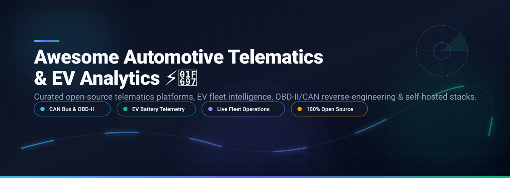

  

# Awesome Automotive Telematics & EV Analytics 🌟🚗⚡

  
  
  
  
  
  
  

> 🛰️ **Curated open-source telematics platforms, EV analytics tools, fleet management systems, CAN bus reverse-engineering stacks, and OBD-II diagnostics.**  
> 💡 *A community resource prioritizing self-hostable tools, data ownership, zero per-vehicle SaaS subscription fees, and smart charging infrastructure.*  
> 🌟 **Star if you like it!** 🌟

---

## 📖 Overview & SEO Focus 🔍

Automotive telematics and electric vehicle (EV) analytics platforms aggregate real-time vehicle telemetry—including GPS coordinates, OBD-II diagnostic trouble codes (DTC), CAN bus signals, battery state of charge (SoC), state of health (SoH), driver safety scores, regenerative braking efficiency, and smart charging sessions (OCPP/ISO 15118). 

Whether you are building autonomous vehicle pipelines, orchestrating smart commercial fleet operations, collecting private Tesla/BYD metrics, or developing open-source hardware controllers, this directory indexes top self-hosted and open-source GitHub software alongside key enterprise platforms.

---

## 📑 Table of Contents 📌

- [Sector Overview & Market Dynamics](#-sector-overview--market-dynamics-)
- [SaaS / Hosted Platforms](#-saas--hosted-platforms-)
- [Open-Source GitHub Projects](#-open-source-github-projects-)
  - [Top Open-Source Telematics & EV Repositories (Ranked by Stars)](#-top-open-source-telematics--ev-repositories-ranked-by-stars-)
  - [Full Fleet Tracking & Telematics Platforms](#-full-fleet-tracking--telematics-platforms-)
  - [EV Telemetry, Battery Analytics & Smart Charging](#-ev-telemetry-battery-analytics--smart-charging-)
  - [OBD-II, CAN Bus, Dongles & Hardware Reverse Engineering](#-obd-ii-can-bus-dongles--hardware-reverse-engineering-)
  - [Additional Notable Frameworks & Protocols](#-additional-notable-frameworks--protocols-)
- [Star History](#-star-history-)
- [Support](#-support-)
- [How to Contribute](#-how-to-contribute-)
- [Disclaimer](#-disclaimer-)

---

## 📊 Sector Overview & Market Dynamics 🌐

The global automotive commercial telematics and EV fleet management market was estimated at approximately **$75 Billion to $85 Billion in 2024–2025** and is projected to expand past **$180 Billion by 2030–2032** at an annual compound growth rate (CAGR) of ~15–18%, propelled by mandatory electronic logging device (ELD) regulations, corporate net-zero electrification mandates, and AI-enabled video telematics.

The sector is **moderately fragmented** rather than a winner-take-all monopoly: while telecommunications giants (Verizon Connect) and high-growth IoT pure-plays (Samsara, Geotab) command substantial market share in long-haul freight and commercial logistics, regional compliance variations, diverse vehicle proprietary CAN architectures, specialized last-mile delivery demands, and stringent data-sovereignty requirements sustain hundreds of specialized regional vendors and accelerate the rapid adoption of **self-hosted, open-source telematics stacks**.

---

## 🏢 SaaS / Hosted Platforms ☁️

These are popular commercial automotive telematics, fleet management, and EV analytics platforms (closed-source / hosted), sorted descending by company size (valuation / market capitalization):

| Platform | Company Size (Valuation / Market Cap) | Starting Pricing | Free Tier / Free Trial Limits | Description |
| :--- | :--- | :--- | :--- | :--- |
| **[Verizon Connect](https://www.verizonconnect.com/)** | ~$190B Market Cap (Parent Verizon) / ~$138B Revenue | ~$20 – $25 / vehicle / month | 30-day free trial (starts 5 days post-hardware shipment; requires demo/sales activation; hardware return required if not subscribing) | Comprehensive fleet tracking, routing, compliance, and telematics with strong North American coverage. |
| **[Webfleet](https://www.webfleet.com/)** | ~$33B Market Cap (Parent Bridgestone; €910M / ~$1B unit acq.) | ~$15 – $35 / vehicle / month (£10 – £35/mo) | Free live demo & custom pilot trial program (duration agreed upon with sales; no self-serve free forever tier) | European-focused fleet management with real-time tracking, tachograph integration, and EV optimization. |
| **[Samsara](https://www.samsara.com/)** | ~$24B Market Cap / ~$1.7B ARR | ~$27 – $33 / vehicle / month | 30-day free trial (includes test hardware returnable within 30 days via provided label; no permanent free tier) | Cloud-based fleet platform combining GPS tracking, AI cameras, EV charging management, and real-time dashboards. |
| **[Trimble Transportation](https://www.trimble.com/)** | ~$12.6B Market Cap / ~$3.8B Revenue | ~$30 – $100 / vehicle / month (modular fleet tracking) | 14-day free trial on developer/routing tools (PC*Miler); live product demonstration / pilot evaluation for core TMS (no permanent free tier) | Enterprise transportation management, fleet telematics, routing, and logistics optimization. |
| **[Teletrac Navman](https://www.teletracnavman.com/)** | ~$5.8B Market Cap (Parent Vontier; ~$220M majority divestment) | ~$25 – $35 / vehicle / month (min. 3 vehicles) | Live scheduled demo & customized test walkthrough (no self-serve free tier; requires sales engagement) | GPS fleet tracking, TN360 AI-powered analytics, driver behavior, and asset management solutions. |
| **[Motive](https://gomotive.com/)** | ~$2.85B Valuation / ~$600M ARR | ~$20 – $25 / vehicle / month (Starter tier) | 90-day free trial available for select add-on workforce software features; live interactive demo for fleet tracking (no permanent free tier) | AI-powered fleet management with ELD, AI dashcams, spend management, and vehicle health monitoring. |
| **[Geotab](https://www.geotab.com/)** | ~$2B+ Valuation (Est.) / ~$800M+ Revenue | ~$30 – $40 / vehicle / month (GO Core Plan) | Free pilot demo device evaluation unit through authorized resellers & interactive software demo (no self-serve permanent free tier) | Leading telematics platform with GO devices, extensive vehicle data, EV-specific insights, and Marketplace integrations. |
| **[Cartrack](https://www.cartrack.com/)** | ~$1.7B Market Cap (Parent Karooooo Ltd) / ~$354M ARR | ~$6 – $20+ / vehicle / month (from R99 – R260/mo) | Scheduled live demo & guided fleet consultation (no self-serve free tier or free trial) | Global vehicle tracking, stolen vehicle recovery, and fleet analytics platform with 2M+ subscribers. |
| **[PowerFleet](https://www.powerfleet.com/)** | ~$280M Market Cap / ~$450M Revenue (Combined) | ~$30 – $60 / vehicle / month | Live software demonstration & enterprise pilot walkthrough via Unity platform (no self-serve free tier) | Industrial and commercial vehicle telematics with asset tracking, VisionAI, and IoT integration. |
| **[Fleet Complete](https://www.fleetcomplete.com/)** | ~$200M Acquisition Value (Acquired by Powerfleet) / ~$105M ARR | ~$15 – $40 / vehicle / month | Scheduled live product demonstration & fleet needs assessment (no self-serve free tier) | End-to-end fleet management with telematics, ELD compliance, and field service tools. |

---

## 🛠️ Open-Source GitHub Projects 💻

Open-source alternatives, firmware, reverse-engineering tools, and software you can self-host, run on your own hardware, or customize without monthly per-device fees.

### 🏆 Top Open-Source Telematics & EV Repositories (Ranked by Stars) ⭐

All repositories sorted descending by GitHub star count:

1. **[commaai/openpilot](https://github.com/commaai/openpilot)**   
   Open-source driver assistance system (ADAS) that performs automated cruise control, lane centering, and forward collision warnings for 250+ supported car models. Built upon extensive CAN/video telematics.

2. **[teslamate-org/teslamate](https://github.com/teslamate-org/teslamate)**   
   A powerful, self-hosted data logger for Tesla vehicles written in Elixir. Visualizes driving efficiency, vampire drain, battery degradation, charging curves, and trip history through Grafana dashboards without exposing telemetry to third parties.

3. **[traccar/traccar](https://github.com/traccar/traccar)**   
   The world's leading open-source GPS tracking and telematics server. Supports 200+ communication protocols and 2,000+ tracker models. Features geofencing, driver behavior scoring, trip reports, notifications, and REST APIs.

4. **[evcc-io/evcc](https://github.com/evcc-io/evcc)**   
   Extensible EV charging controller designed for solar photovoltaic (PV) surplus charging and dynamic electricity tariffs. Supports dozens of wallboxes, home energy management systems (HEMS), and vehicle telemetry APIs.

5. **[fleetbase/fleetbase](https://github.com/fleetbase/fleetbase)**   
   Modular open-source logistics and supply chain operating system (LSOS). Delivers end-to-end fleet tracking, route dispatching, real-time vehicle telematics, service orders, and webhooks.

6. **[commaai/opendbc](https://github.com/commaai/opendbc)**   
   Comprehensive open repository of DBC files and Python APIs for decoding CAN bus telemetry (gas, brake, steering wheel angle, wheel speeds, radar signals) across modern automotive brands.

7. **[commaai/panda](https://github.com/commaai/panda)**   
   Universal vehicle interface hardware and firmware supporting 3x CAN, 2x LIN, and GPS. Connects vehicle OBD-II/CAN networks to computers over USB and Wi-Fi.

8. **[brendan-w/python-OBD](https://github.com/brendan-w/python-OBD)**   
   Python module for communicating with ELM327 OBD-II adapters. Reads vehicle sensor data, diagnostic trouble codes (DTCs), RPM, speed, engine load, and real-time fuel efficiency.

9. **[openvehicles/Open-Vehicle-Monitoring-System-3](https://github.com/openvehicles/Open-Vehicle-Monitoring-System-3)** (OVMS)   
   Hardware and firmware for complete EV remote telemetry, diagnostics, and climate control. Monitors state of charge, individual cell temperatures, tyre pressures, and alerts via cellular/Wi-Fi.

10. **[EVerest/everest-core](https://github.com/EVerest/everest-core)**   
    Open-source EV charging operating system by the Linux Foundation Energy (LFE). Implements OCPP 1.6/2.0.1, ISO 15118 (Plug & Charge), and dynamic charge management.

11. **[OpenEVSE/openevse_esp32_firmware](https://github.com/OpenEVSE/openevse_esp32_firmware)**   
    ESP32 WiFi/BLE gateway firmware for OpenEVSE smart charging stations. Enables real-time energy monitoring, MQTT telemetry, solar tracking, and OCPP server integration.

12. **[uhi22/pyPLC](https://github.com/uhi22/pyPLC)**   
    Python implementation of CCS (Combined Charging System) Powerline Communication (PLC) based on DIN 70121 and ISO 15118 for EV charging analysis, sniffer logs, and smart charging research.

13. **[iUnreallx/ReDrive](https://github.com/iUnreallx/ReDrive)**   
    Modern cross-platform OBD2 dashboard application written in Flutter. Displays live vehicle metrics, custom digital gauge clusters, and reads/clears ECU trouble codes via ELM327 adapters.

14. **[gx0r/agilegps](https://github.com/gx0r/agilegps)**   
    Multi-tenant real-time fleet telematics system built with Node.js and RethinkDB. Engineered specifically for Queclink GPS tracking hardware and live OBD telemetry.

15. **[angoikon/byd-trip-stats](https://github.com/angoikon/byd-trip-stats)**   
    Native Android telemetry dashboard for BYD electric & hybrid vehicles (DiLink infotainment systems). Records trip energy efficiency, realistic remaining range, battery cell thermal heatmaps, and offline logs.

16. **[tzebrowski/ObdGraphs](https://github.com/tzebrowski/ObdGraphs)**   
    Android diagnostic telemetry tool designed for high-frequency graphing of ELM327 and STN1170 OBD parameters with multi-sensor CSV export.

17. **[speed785/open-mechanic](https://github.com/speed785/open-mechanic)**   
    AI-assisted vehicle diagnostic engine that pairs OBD-II adapter inputs with LLMs to provide plain-language fault diagnostics and step-by-step repair guides.

18. **[WayBetterSolutions/OCTAVE](https://github.com/WayBetterSolutions/OCTAVE)**   
    Modular infotainment and telematics OS designed for Raspberry Pi, laptops, and in-car embedded displays with OBD-II integration and custom digital dash skins.

19. **[bkbilly/Routario](https://github.com/bkbilly/Routario)**   
    Self-hosted vehicle tracking suite featuring real-time map plotting, geofence enter/exit triggers, sensor event logs, and no external cloud dependency.

20. **[appspace/kwwhat](https://github.com/appspace/kwwhat)**   
    Data build tool (dbt) data models transforming raw OCPP charging logs into executive EV analytics on charger uptime, utilization, and failed charging attempts.

21. **[sachnaror/fleet-management-system](https://github.com/sachnaror/fleet-management-system)**   
    FastAPI & Python microservice architecture for vehicle fleet monitoring, CAN/GPS intake, driver violation scoring, and live maintenance scheduling.

22. **[Mindfactory89/ev-charging-dashboard](https://github.com/Mindfactory89/ev-charging-dashboard)**   
    PWA and web dashboard for tracking multi-vehicle EV charging cycles, charging efficiency forecasts, session costs, and PostgreSQL storage.

23. **[erc-fhv/open-ev-fleet](https://github.com/erc-fhv/open-ev-fleet)**   
    Scientific simulation and MILP optimization suite written in Julia and Python for electric commercial fleet scheduling, depot charging, and battery degradation modeling.

---

### 🚚 Full Fleet Tracking & Telematics Platforms 📍

- **[Traccar](https://github.com/traccar/traccar)** — Enterprise-ready Java GPS tracking server supporting virtually all cellular GPS protocols, push notifications, and customizable map layers.
- **[Fleetbase](https://github.com/fleetbase/fleetbase)** — Full-featured supply chain and fleet operations OS with routing optimization, live dispatch consoles, and open developer APIs.
- **[Routario](https://github.com/bkbilly/Routario)** — Lightweight, privacy-respecting GPS tracking platform with geofence boundaries and trip replay.
- **[AgileGPS](https://github.com/gx0r/agilegps)** — Real-time tracking architecture tailored for Queclink trackers and remote OBD-II diagnostic streaming.

---

### ⚡ EV Telemetry, Battery Analytics & Smart Charging 🔋

- **[TeslaMate](https://github.com/teslamate-org/teslamate)** — Self-hosted Docker stack collecting Tesla telemetry via Streaming API; provides deep battery health degradation curves, vampire loss tracking, and trip costs.
- **[evcc](https://github.com/evcc-io/evcc)** — Smart EV charging controller written in Go. Prioritizes renewable solar energy, dynamically optimizes charging times against spot electricity prices, and interfaces with dozens of wallbox models.
- **[EVerest Core](https://github.com/EVerest/everest-core)** — Linux Foundation Energy initiative standardizing EVSE charging controller stacks, supporting ISO 15118 and OCPP 2.0.1.
- **[OpenEVSE WiFi](https://github.com/OpenEVSE/openevse_esp32_firmware)** — Open charging hardware firmware with REST, MQTT, and OCPP telemetry hooks.
- **[BYD Trip Stats](https://github.com/angoikon/byd-trip-stats)** — In-car analytics APK for BYD electric cars calculating true battery range, consumption curves, and thermal health.
- **[pyPLC](https://github.com/uhi22/pyPLC)** — Combined Charging System (CCS) DIN 70121 / ISO 15118 powerline communication sniffer and tester.
- **[open-ev-fleet](https://github.com/erc-fhv/open-ev-fleet)** — Academic simulation frameworks for optimal commercial EV fleet dispatching and depot charging.
- **[kWwhat](https://github.com/appspace/kwwhat)** — dbt data transformation pipelines for EV charging station reliability and uptime metrics.
- **[EV Charging Dashboard](https://github.com/Mindfactory89/ev-charging-dashboard)** — Self-hosted charging cost and session tracking dashboard.

---

### 🔌 OBD-II, CAN Bus, Dongles & Hardware Reverse Engineering 🚗

- **[comma openpilot](https://github.com/commaai/openpilot)** — Cutting-edge autonomous driving agent and telematics processor.
- **[comma opendbc](https://github.com/commaai/opendbc)** — The industry standard open repository of CAN bus DBC definitions and vehicle signal decoders.
- **[comma panda](https://github.com/commaai/panda)** — The universal OBD-II to USB/WiFi vehicle interface hardware.
- **[python-OBD](https://github.com/brendan-w/python-OBD)** — Reliable Python library to interface with ELM327 Bluetooth/USB diagnostics.
- **[OVMS 3](https://github.com/openvehicles/Open-Vehicle-Monitoring-System-3)** — Hardware and software telemetry module connecting EV CAN networks to self-hosted servers via cellular/WiFi.
- **[ReDrive](https://github.com/iUnreallx/ReDrive)** — Polished Flutter OBD-II dashboard for real-time telemetry meters and DTC clearing.
- **[OCTAVE](https://github.com/WayBetterSolutions/OCTAVE)** — DIY telematics and custom digital dashboard display system.
- **[Open Mechanic](https://github.com/speed785/open-mechanic)** — AI-driven vehicle diagnostics matching OBD-II trouble codes with repair recommendations.
- **[ObdGraphs](https://github.com/tzebrowski/ObdGraphs)** — Telemetry charting and high-frequency OBD signal recorder for Android.

---

### 🌐 Additional Notable Frameworks & Protocols 📡

- **[Eclipse CANought](https://projects.eclipse.org/projects/automotive.canought)** — Standardized CAN bus abstraction layer under the Eclipse Software Defined Vehicle (SDV) working group.
- **[Fleet Management System](https://github.com/sachnaror/fleet-management-system)** — Microservices framework in FastAPI for fleet tracking and CAN analysis.

---

## 📈 Star History 🌟

---

## ☕ Support 💖

Thank you so much for exploring and using this collection! Maintaining and curating open-source automotive telematics and EV intelligence resources requires ongoing research and community feedback.

If you find this repository valuable, please consider:
- ⭐ **Starring** the repository on GitHub
- 🍴 **Forking** and contributing your favorite open-source vehicle tools
- 📢 **Sharing** this repository with other automotive developers, fleet engineers, and EV enthusiasts
- ☕ **Sponsoring or buying a coffee** via the [GitHub Sponsors Dashboard](https://github.com/sponsors/ishandutta2007)

Every contribution helps keep this directory up-to-date and comprehensive!

---

## 🤝 How to Contribute 🚀

Contributions are welcome and encouraged!

1. Fork the repository
2. Add a new tool under the appropriate section (keep SaaS and Open-Source strictly separate)
3. Use the established format: **[Repo/Name](link)**  — Description
4. Prefer actively maintained projects with clear documentation and real vehicle/hardware compatibility
5. Submit a Pull Request

---

## ⚠️ Disclaimer 🛡️

This is a community-curated list for informational and educational purposes only. Inclusion does not constitute an official endorsement.

Vehicle data collection, CAN bus interaction, and remote commands involve critical safety and legal implications. Always verify hardware compatibility, vehicle warranty guidelines, cryptographic security, and regulatory compliance (e.g., FMCSA ELD regulations, GDPR, and automotive cybersecurity standards) before attaching hardware or deploying software in active vehicles.

---

  <b>Made with ❤️ for the open-source and automotive community</b> 
  If this project helped you, please ⭐ the repository!

